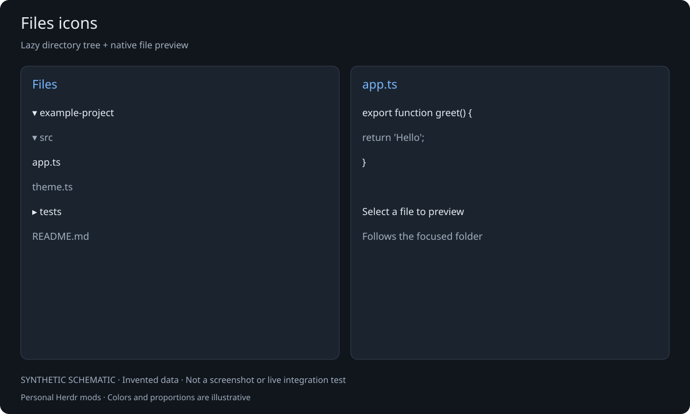

# Files icons

A native Files panel with recognizable file-type colors and lazy folder expansion. Preview is a synthetic schematic, not a live screenshot.

## What you see
A vertical folder tree and bounded, syntax-highlighted file preview using the active theme. Folder/file icons sit beside names; long paths are constrained to the panel.

## How it behaves
Expand a folder to load its children; select a file to preview it. The panel follows the focused pane's current folder and preserves per-context expansion. Local folder watches and a 10-second fallback refresh keep it current. It displays no agent-status indicator.

## Built from
files-icons clones Herdr files. main.js reads spaces/panes/focused, invokes directory listing and Git status, reads file content and watches folders. file-icons.js selects glyphs. EditorState and Editor render previews; local SVGs provide tree controls. Standard Herdr fonts/theme remain external dependencies.

## Watch out
Limit 500 entries per folder and 5,000 total; binary/large/unreadable previews are bounded. Windows listing uses PowerShell, Unix listing uses sh. All local SVGs are pinned Lucide assets. Preserve inherited-code and Lucide/Feather notices. Never overwrite the shipped files mod.

## Done when
Native check passes without reading a live repository; folders expand lazily; file previews and icons render; switching focused folders refreshes the correct context; remote folders use their own machine.
