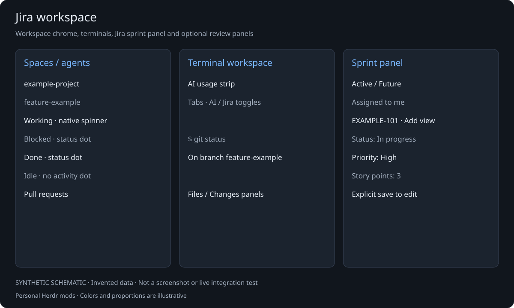

# Jira workspace

A working-terminal layout with spaces/agents/PRs on the left, an AI strip and tab bar above the terminal, and a Jira sprint panel on the right. Preview is a synthetic schematic, not a live screenshot.

## What you see
A 268px sidebar, 64px AI strip, 42px custom tab bar, framed terminal panes, and a 360px Jira panel (280–640px). Files/Changes live in a separately toggled stack. Jira has active/future sprint views, status filters, assigned-to-me filtering, issue cards and a native edit dialog.

## How it behaves
Tabs select, rename on double-click, reorder and close. Jira and AI usage buttons show/hide their panels. Files/Changes selection is remembered per space. Working tabs use a native spinner, blocked/done tabs use theme status dots, idle tabs show neither. Sprint lists refresh every minute; slow story-point lookup does not block navigation. Issue editing saves only after explicit action.

## Built from
The layout references all nine exported custom mods plus shipped workspace-chrome, workspace-status, spaces, agents and pane. jira-tabs uses layout panel IDs, localStorage and native commands. jira-sprint uses acli; issue-dialog.js describes editors and description-format.js converts Markdown/ADF using vendored Marked. The exported Changes stack directly uses review-changes, not Gitview.

## Watch out
Set BOARD, STORY_POINTS, CLI and YOUR_SITE in exported Jira source before use. Install every sibling bundle for this exact layout. Retain panel IDs and asset paths. Native checks do not test authenticated Jira writes or the full layout. The Jira mark is replaced by a neutral Lucide panel icon. All bundled SVG glyphs have pinned Lucide provenance. Preview data is invented; live Jira mutation workflows still need manual testing.

## Done when
Both mods pass native checks; all referenced bundles are installed; configured sprint views and filters work during detail loading; edited issues refresh cached copies; AI/Jira/Files/Changes toggles target their own panels; no private site or board remains in committed examples.
