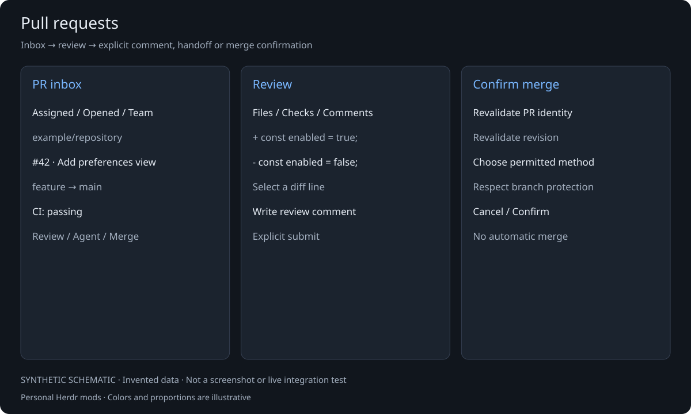

# Pull requests

A GitHub-style PR inbox with native diff review, comments, agent handoff and guarded merge confirmation. Preview is a synthetic schematic, not a live screenshot.

## What you see
Compact/full PR cards with title, repository, author, source/target branches, overall CI status and action row. Semantic light/dark GitHub colors, green merge actions, coral active inbox underline and blue branch chips. Review opens at 94% window width and 92% height with files, checks and comments. Merge uses a separate confirmation dialog.

## How it behaves
Assigned, Opened, Review requested and Team inboxes refresh every minute. Team defaults to the selected CLI user; configure logins explicitly. Account selection switches gh globally. Diff reads PR changes without checkout. Comments and approvals require explicit user actions. Merge verifies identity/revisions and allowed method, warns for other authors, and respects GitHub branch protection. Agent picker lists Pi first and current-space agents first within each group; click/Enter inserts, Shift submits. Working/blocked/done/idle agents use accent/blocked/green/dim dots.

## Built from
pr-status is the inbox; pr-review owns file/check/comment views; pr-merge owns confirmed GraphQL merge; pr-agent sends via configured Gitview transport. All use gh with local auth. Models separate data and safety predicates from native views. All bundled glyphs are pinned Lucide SVGs; existing Primer color attribution remains.

## Watch out
Install all four mods together. Gitview transport is an external optional requirement for handoff. PR content is untrusted; the agent prompt is not a security sandbox. Drafts can be lost on modal close. API truncation, search indexing and snapshot changes must remain visible. Original contribution licensing remains pending; current glyphs have a pinned Lucide inventory.

## Done when
All four native checks and fake-data tests pass; reviewer opens exact PR in a modal; branch/CI states distinguish pending/failed/partial; account changes invalidate stale data; cancel causes no mutations; merge requires fresh explicit confirmation.
