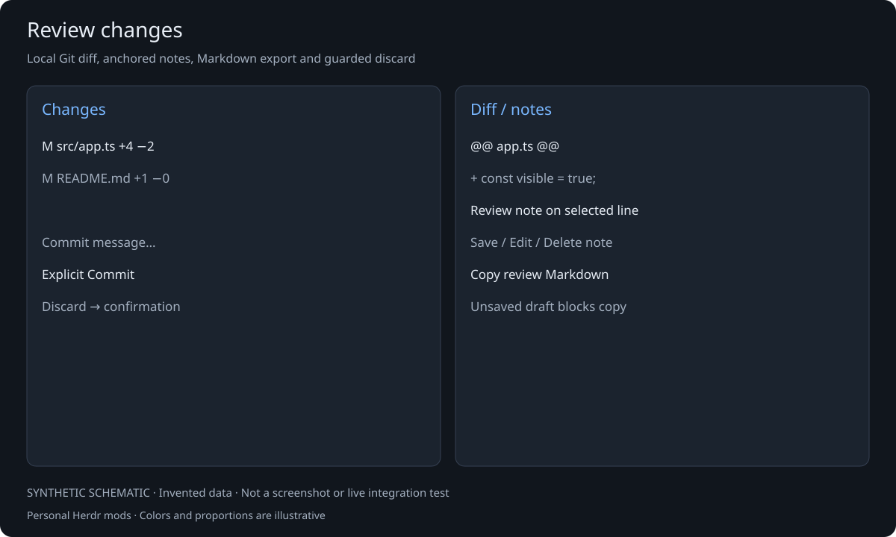

# Review changes

A local Git changes panel with diff-anchored review notes and copyable review Markdown. Preview is a synthetic schematic, not a live screenshot.

## What you see
A file list with status and add/delete counts, syntax-colored unified diff, review-note controls, commit message and explicit file-discard confirmation. Theme colors follow Herdr, with bounded virtualized diff rows.

## How it behaves
Follows the focused repository/machine; polls every 10 seconds and watches local folders. Select lines to attach notes, edit/delete them, then copy complete review Markdown. Unsaved notes block copying instead of disappearing silently. Commit and discard run only on explicit user action; discard validates the selected file snapshot and index before altering it. No agent-status list is displayed.

## Built from
Herdr changes clone. main.js uses spaces/panes/focused, Git via exec, readTextFile/watchFolder, and shared review-note state. review.js models anchors, Markdown export and snapshot-checked discard. Native Textarea/Input and virtual lists provide editing and rendering.

## Watch out
Review exports contain repository path and machine context; sharing them may disclose local metadata. Clipboard command is macOS pbcopy. Discard is destructive and handles staged as well as unstaged changes. Do not bundle shared state or existing notes. Inherited Herdr v0.1.14 Apache-2.0 provenance is documented; original contribution licensing and historical asset clearance remain pending.

## Done when
Native check and temporary-repository tests pass; notes remain isolated by repository/machine; copied Markdown includes saved notes but refuses drafts; discard refuses changed snapshots and leaves sibling files untouched; cancelling confirmation changes nothing.
